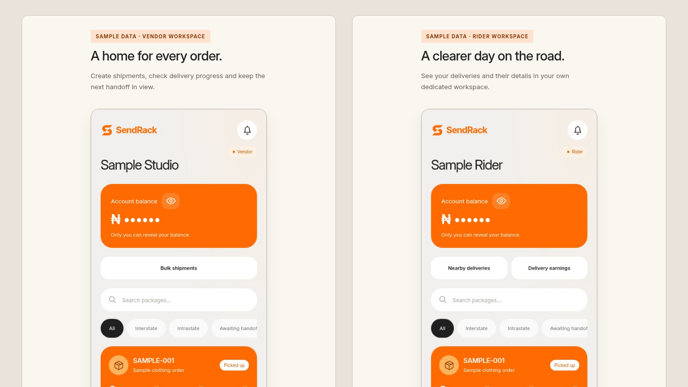
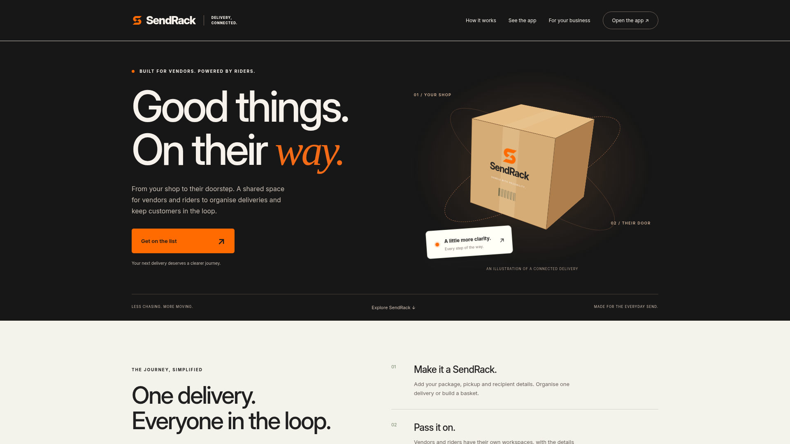
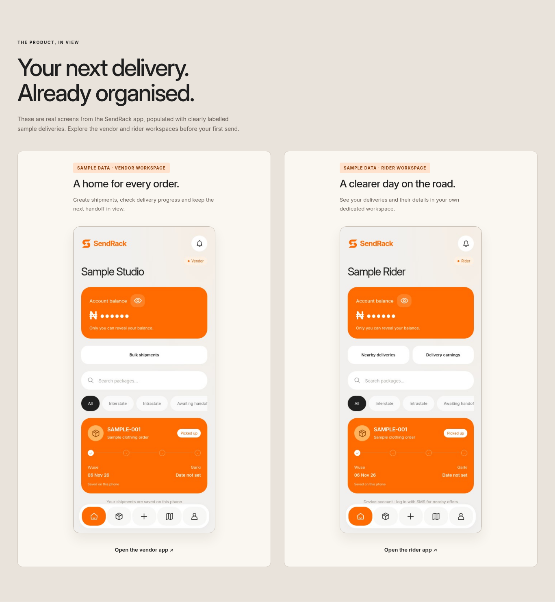

# SendRack layout fix screenshots

Local verification screenshots; product screens show actual SendRack application components with synthetic, clearly labelled sample data. No production customer data is used.

## Laptop — 1366 × 768

[Full page](1366x768.png)

## Desktop — 1920 × 1080

[Full page](1920x1080.png)

## Actual product previews — sample data

## Mobile

[390 × 844 full page](390x844.png) · [360 × 800 full page](360x800.png)
