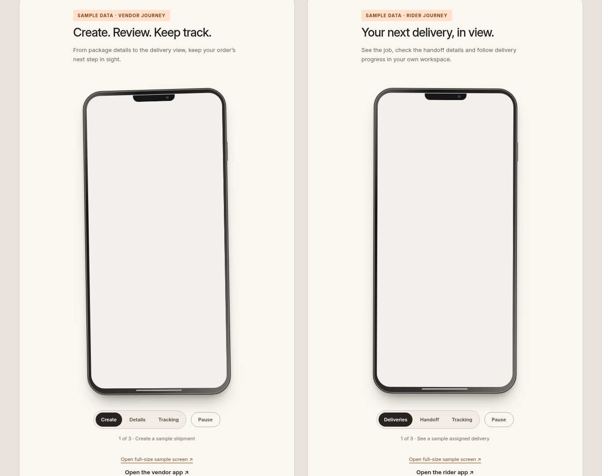

# Route setup and phone demonstrations — before deployment

All screenshots and the recording use disposable local fixtures and clearly labelled fictional sample data. They do not show production records.

## Animation recording

[Watch/download the 20-second MP4](animation.mp4). Recorded at 1366×1080, 12 fps, H.264. It shows the real website CSS motion and screen transitions, then exercises Pause and manual screen selection. No production data or live GPS is simulated.

## Route setup

- [Intrastate — laptop 1366×768](intrastate-1366.png)
- [Interstate — laptop 1366×768](interstate-1366.png)
- [Intrastate — desktop 1920×1080](intrastate-1920.png)
- [Interstate — desktop 1920×1080](interstate-1920.png)
- [Intrastate — mobile 390×844](intrastate-390.png)
- [Interstate — mobile 390×844](interstate-390.png)

The form body scrolls; the Save/Cancel footer stays visible. Intrastate uses one state and one handler fee; Interstate requires different states and three handler fees.

## Phone demonstrations and full website

- [Phones — laptop](phones-1366.png) · [Full laptop page](site-1366.png)
- [Phones — desktop](phones-1920.png) · [Full desktop page](site-1920.png)
- [Phones — 390 px](phones-390.png) · [Full mobile page](site-390.png)
- [Phones — 360 px](phones-360.png) · [Full mobile page](site-360.png)

Screenshots use reduced-motion mode for stable comparison. The recording uses normal motion. Device widths were tested in Chromium, not on physical iPhone/Android hardware.
